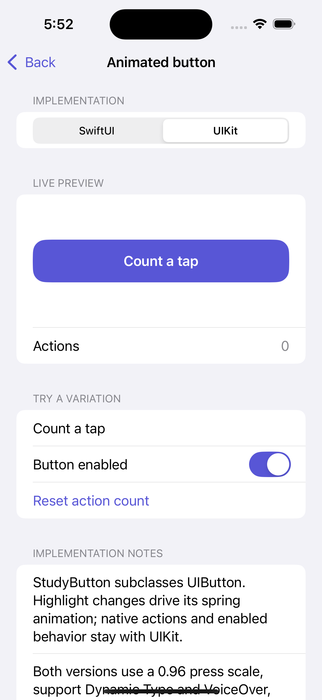

# Animated button

**Status:** reusable component, experimental API. **Minimum OS:** iOS 18.

## Goal

Explore subtle press feedback while preserving native button behavior in SwiftUI and UIKit. Both versions use an indigo fill, a white headline label, 16-point corners, at least 52 points of height, and a pressed scale of 0.96.

The gallery owns the title, enabled state, and action count. Switching frameworks keeps those settings. The component owns only presentation and press feedback.

## Gallery

| SwiftUI | UIKit |
| --- | --- |
|  |  |

## Comparison

| Concern | SwiftUI | UIKit |
| --- | --- | --- |
| Public API | `StudyButtonStyle(tint: Color = .indigo)` | `StudyButton(frame:)` or storyboard initializer |
| Label | Native `Button` label | `setTitle(_:for:)` |
| Color | Style's `tint` parameter | `tintColor`, defaults to `.systemIndigo` |
| Press feedback | `ButtonStyle.Configuration.isPressed` | `UIButton.isHighlighted` |
| Action | Native `Button` action closure | `.primaryActionTriggered` using target/action or `UIAction` |
| Disabled state | `.disabled(true)` with reduced opacity | Native `isEnabled` and configuration appearance |
| Text scaling | `.headline` | Preferred headline font refreshed on content-size changes |
| Reduce Motion | Accessibility environment value | System setting and change notification |

SwiftUI and UIKit use their own spring systems, so motion and native disabled rendering are comparable rather than pixel-identical. A minimum height allows the controls to grow for larger text. The gallery gives each preview the available row width; the UIKit bridge measures the wrapping label at SwiftUI’s proposed width. Use a descriptive nonempty label; empty titles are allowed for experimentation but are not suitable accessible names for real controls.

## SwiftUI

```swift
import SwiftUI
import StudySwiftUI

Button("Save changes") {
    saveChanges()
}
.buttonStyle(StudyButtonStyle(tint: .indigo))
.disabled(isSaving)
```

For a custom label, provide an accessible name when its visible contents do not already supply one.

## UIKit

```swift
import UIKit
import StudyUIKit

// Configure on the main actor, as with other UIKit controls.
let button = StudyButton(frame: .zero)
button.setTitle("Save changes", for: .normal)
button.tintColor = .systemIndigo
button.isEnabled = !isSaving
button.addAction(UIAction { _ in
    saveChanges()
}, for: .primaryActionTriggered)
```

Use Auto Layout or your host's layout system to position the button. It supplies an intrinsic size and a minimum-height constraint.

## Accessibility and checks

- Native button semantics preserve VoiceOver activation and disabled state.
- Reduce Motion suppresses scale feedback. UIKit also clears an in-flight transform animation when the setting changes.
- Text uses Dynamic Type and can wrap. Test long labels and accessibility sizes within the available width.
- System colors adapt to light/dark appearance; consumers choosing custom colors should check label contrast.
- The gallery UI test covers action counts, framework switches, and disabled state.

## Inspiration and attribution

Original implementation for Components Studies using standard Apple button APIs and spring animation. No external design assets or third-party code.
