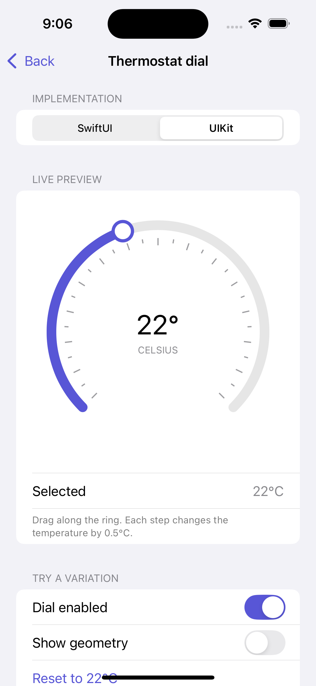

# Thermostat dial

A reusable, experimental Celsius selector for iOS 18+, written independently in SwiftUI and UIKit. Default: **22°C**, range **16–30°C**, step **0.5°C**. This selects a setpoint; it does not simulate or connect to heating equipment.

## Try it

Open **Thermostat dial** in the gallery. Tap or drag on the ring, switch frameworks, disable the control, or turn on **Show geometry**. The page owns the temperature and settings, so switching implementations preserves them. The orange center and dashed touch ray explain the geometry; the accompanying readouts show the selected angle and normalized progress.

 

## 1. Draw the coordinate system

The dial is a square. Its center is `(width / 2, height / 2)` and its radius is half the shorter dimension minus 24 points. Screen coordinates increase rightward and downward. A circle point is:

```text
x = center.x + cos(angle) × radius
y = center.y + sin(angle) × radius
```

Angles in these formulas are radians. The arc starts at 135° (lower left), moves clockwise through 270°, and ends at 405° (lower right). That leaves a 90° gap at the bottom.

| Drawing | SwiftUI | UIKit |
| --- | --- | --- |
| Track and progress | `Shape` paths and strokes | Core Graphics paths in `CAShapeLayer`; `strokeEnd` selects progress |
| Ticks | One path containing short lines | One shape layer with the same line geometry |
| Indicator | Positioned circle | Ellipse path in a shape layer |
| Readout | Dynamic Type `Text` | Dynamic Type `UILabel` |
| Interaction | Ring-shaped hit region and `DragGesture` | `UIControl` touch tracking |
| Feedback | Selection sensory feedback | `UISelectionFeedbackGenerator` |

The 28 tick divisions are visual scale marks; configurable value steps are independent of tick density. Shape drawing is sufficient for these few paths. No Metal renderer or continuous render loop is needed.

## 2. Convert a touch into an angle

Subtract the center from the touch position. `atan2(dy, dx)` gives the direction in radians; multiply by `180 / π` for degrees. Subtract the 135° start angle and normalize into `0..<360`.

At the top of the ring, the relative angle is 135°, halfway through the sweep. At the right edge it is 225°.

A gesture must begin within 28 points of the ring and on the active arc. Center and bottom-gap starts do nothing. Once tracking, the finger may drift outside the ring. Entering the inner dead zone pauses angular sampling; returning resumes without treating the center crossing as a large turn.

## 3. Prevent the bottom-gap jump

A normalized angle wraps at 360°. During a drag, remember the previous angle and accumulate the shortest signed difference:

```text
delta = newAngle − previousAngle
if delta > 180: delta -= 360
if delta < -180: delta += 360
continuousAngle += delta
```

Thus 359° → 1° is +2°, not −358°. Keep the overshoot in this continuous angle and clamp only the resulting progress. Dragging through the bottom gap remains pinned at the endpoint until the finger retraces its overshoot. A new gesture starts fresh, so tapping either endpoint still works. Multiple complete turns retain their overshoot; this is a bounded selector, not an endlessly rotating knob.

## 4. Map and snap the value

```text
progress = clamp(continuousAngle / 270, 0, 1)
rawValue = minimum + progress × (maximum − minimum)
value = minimum + round((rawValue − minimum) / step) × step
value = clamp(value, minimum, maximum)
```

At the top: `16 + 0.5 × 14 = 23°C`. At the right: the raw value is about 27.67°C, which snaps to 27.5°C. Rounding is relative to the minimum, so custom ranges work correctly.

Drawing goes in the reverse direction: selected value → progress → angle → indicator position. There is one selected value, not separate visual and logical values that can drift apart.

## 5. Send changes without loops

SwiftUI writes its binding only after a user selects a different snapped value. UIKit's private selection method emits `.valueChanged` only when a user changes the value. Assigning its `temperature` property updates the display without emitting an event.

The gallery bridge installs one target in `makeUIView`, refreshes the coordinator binding in `updateUIView`, and forwards events to the parent's state. Programmatic updates therefore cannot echo back as duplicate user events.

## Usage

```swift
import SwiftUI
import StudySwiftUI

struct TemperatureSetting: View {
    @State private var temperature = 22.0
    var body: some View {
        StudyThermostatDial(temperature: $temperature)
            .frame(width: 280, height: 280)
    }
}
```

```swift
import StudyUIKit

let dial = StudyThermostatDial(temperature: 22, range: 16...30, step: 0.5)
dial.addAction(UIAction { [weak dial] _ in
    guard let dial else { return }
    print(dial.temperature)
}, for: .valueChanged)
```

UIKit creation and updates belong on the main actor. When importing both modules, qualify the name with `StudySwiftUI.` or `StudyUIKit.`. Give the control a square frame, ideally 240 points or larger.

Configuration requires finite increasing bounds and a positive finite step dividing the span into 1...1000 whole steps. Invalid configuration fails a precondition. UIKit configuration is fixed at initialization. Values snap and clamp; nonfinite values resolve to the minimum. SwiftUI displays normalized external values without mutating the binding during rendering; user changes write normalized values back.

## Accessibility and motion

Both versions expose one adjustable accessibility element named Temperature, with a spoken Celsius value. Increment/decrement changes one step; disabled controls ignore adjustments. Text uses Dynamic Type and scales to fit the bounded center. The gallery also shows a regular text readout outside the dial. Colors adapt to system appearance.

The arc and indicator follow snapped values directly, with no interpolated motion. When the temperature changes, the number readout rolls only the digits that changed; separators and the degree mark remain stationary. Reduce Motion replaces rolling with a brief fade. SwiftUI uses a numeric content transition; UIKit uses clipped digit columns. The transition changes only the visual text; the parent control exposes one stable accessibility value. Selection haptics occur only on user value changes, including accessibility adjustments; hardware support determines whether they are felt.

## Tests and credits

Each independent module runs the same geometry tests: scale boundaries, snapping, coordinate directions, gap crossing, and reversal. UIKit tests cover accessibility adjustments, disabled state, event counts, and programmatic assignments. Gallery tests cover both frameworks and shared state on iPhone and iPad.

Original implementation inspired by generic wall thermostats and rotary instrument scales; no third-party code, assets, or product design was copied.

Apple references: [UIControl touch tracking](https://developer.apple.com/documentation/uikit/uicontrol/begintracking(_:with:)), [SwiftUI sensory feedback](https://developer.apple.com/documentation/swiftui/sensoryfeedback), and [adjustable accessibility actions](https://developer.apple.com/documentation/swiftui/view/accessibilityadjustableaction(_:)).

## Validation record

Verified on iOS 18.6: all seven package tests pass; gallery tests pass on iPhone 16 and iPad (10th generation). Both products build independently, and unsigned package/gallery test compilation succeeds. Light and dark appearance and maximum accessibility text were visually checked on iPhone; normal iPad layout was checked. VoiceOver speech, the system Reduce Motion setting, and physical haptics remain manual checks.
