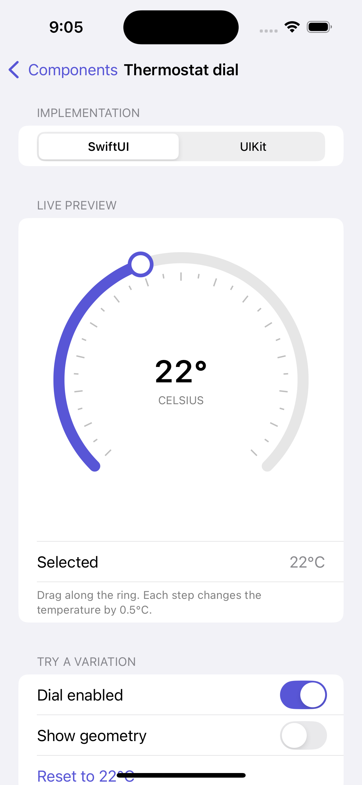
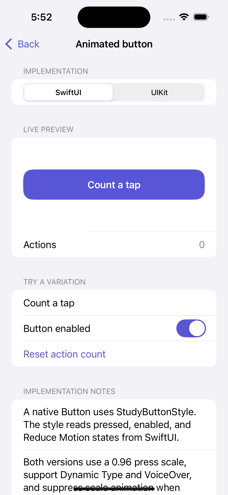

# Swift View Lab

A small laboratory for custom iOS interfaces: the same idea explored in **SwiftUI and UIKit**, with reusable components you can bring into your own apps.

## Requirements

- Xcode 16 or later, Swift 6, and an iOS Simulator runtime
- iOS 18 or later; iPhone and iPad
- No third-party dependencies or Apple developer team needed for simulator builds

## Run the gallery

1. Clone [viennarzc/swift-view-lab](https://github.com/viennarzc/swift-view-lab) or download its source.
2. Open `Examples/ComponentGallery/ComponentGallery.xcodeproj` in Xcode.
3. Select the **ComponentGallery** scheme and an iPhone or iPad simulator, then click **Run**.
4. Choose **Thermostat dial** or **Animated button** in the gallery. Switch between SwiftUI and UIKit, adjust the demo settings, and compare the paired implementations.

The gallery keeps each study's demo state above the framework switcher, so changing implementations preserves the selected value and settings. For a physical device, choose your own development team and a unique bundle identifier in the app target's Signing & Capabilities settings.




## Studies

| Study | SwiftUI | UIKit | Status |
| --- | --- | --- | --- |
| [Thermostat dial](Documentation/Studies/ThermostatDial.md) | `StudyThermostatDial` | `StudyThermostatDial` | Reusable, experimental API |
| [Animated button](Documentation/Studies/AnimatedButton.md) | `StudyButtonStyle` | `StudyButton` | Reusable, experimental API |

Experiments live in the gallery. Components promoted for reuse live in the package. APIs may change before the first stable release.

## Use the components

### Local checkout

In your app's Xcode project, select **File → Add Package Dependencies → Add Local**, choose this repository's root directory, and add `StudySwiftUI`, `StudyUIKit`, or both to your app target.

### From GitHub

In **File → Add Package Dependencies**, enter `https://github.com/viennarzc/swift-view-lab.git` and select the `main` branch. Add `StudySwiftUI`, `StudyUIKit`, or both to your app target. After a release is tagged, use its version rule.

```swift
import SwiftUI
import StudySwiftUI

struct ExampleView: View {
    var body: some View {
        Button("Continue") {
            // Perform your action.
        }
        .buttonStyle(StudyButtonStyle())
    }
}
```

```swift
import UIKit
import StudyUIKit

@MainActor
func makeButton() -> StudyButton {
    let button = StudyButton(frame: .zero)
    button.setTitle("Continue", for: .normal)
    button.addAction(UIAction { _ in
        // Perform your action.
    }, for: .primaryActionTriggered)
    return button
}
```

Each library is independent. SwiftUI/UIKit bridging belongs to the gallery or your consuming app.

The thermostat APIs are also available from the corresponding product:

```swift
import SwiftUI
import StudySwiftUI

struct TemperatureSetting: View {
    @State private var temperature = 22.0

    var body: some View {
        StudyThermostatDial(temperature: $temperature, range: 16...30, step: 0.5)
            .frame(width: 280, height: 280)
    }
}
```

```swift
import StudyUIKit

let dial = StudyThermostatDial(temperature: 22, range: 16...30, step: 0.5)
dial.addAction(UIAction { _ in
    print(dial.temperature)
}, for: .valueChanged)
```

The UIKit control sends `.valueChanged` for user changes; assigning `temperature` updates it without sending an event. See the [thermostat guide](Documentation/Studies/ThermostatDial.md) for configuration, interaction, accessibility, and implementation details.

## Explore and modify

- To change an existing **demo**, edit its files under `Examples/ComponentGallery/ComponentGallery/Studies/<StudyName>/`. Demo state, settings, geometry overlays, and UIKit representables belong in the gallery.
- To change the **reusable component**, edit the paired implementation under `Sources/StudySwiftUI/<StudyName>/` and `Sources/StudyUIKit/<StudyName>/`. Keep both versions' behavior aligned and update public API documentation when configuration or behavior changes.
- To change the **gallery catalog**, edit `Examples/ComponentGallery/ComponentGallery/Catalog/Study.swift`. The catalog controls the study name, category, summary, symbol, and destination.
- To add a new paired study, follow [Adding a study](Documentation/AddingAStudy.md). It covers the folder layout, shared state, catalog registration, documentation, promotion to the package, and validation.

Open the project in Xcode to edit Swift files and use the **ComponentGallery** scheme to preview changes in a simulator. The app and test targets use synchronized folders, so new Swift files inside the existing source folders are picked up automatically.

## Repository map

| Location | Responsibility |
| --- | --- |
| `Package.swift`, `Sources/` | Reusable libraries and their public APIs |
| `Examples/ComponentGallery/` | Runnable gallery, demo settings, and experiments |
| `Tests/` | Shared geometry and UIKit control behavior tests |
| `Documentation/Studies/` | Study explanations, examples, and credits |
| [AddingAStudy.md](Documentation/AddingAStudy.md) | Step-by-step workflow for the next study |
| [CONTRIBUTING.md](CONTRIBUTING.md) | Contribution and review expectations |

## Build and verify

Run these commands from the repository root:

```sh
xcodebuild -scheme StudySwiftUI -destination 'generic/platform=iOS Simulator' CODE_SIGNING_ALLOWED=NO build
xcodebuild -scheme StudyUIKit -destination 'generic/platform=iOS Simulator' CODE_SIGNING_ALLOWED=NO build
xcodebuild -project Examples/ComponentGallery/ComponentGallery.xcodeproj -scheme ComponentGallery -destination 'generic/platform=iOS Simulator' CODE_SIGNING_ALLOWED=NO build-for-testing
```

Run package behavior tests with `xcodebuild -scheme ComponentsStudies-Package -destination 'platform=iOS Simulator,name=<your simulator>' CODE_SIGNING_ALLOWED=NO test`. These cover dial geometry, snapping, endpoint crossing, and UIKit event delivery.

Run the shared scheme's UI test in Xcode with **Product → Test** on an iPhone and an iPad simulator. It checks single action delivery, shared state when switching frameworks, and disabled state in both versions.

Before contributing, also check light/dark appearance, larger accessibility text, VoiceOver, and Reduce Motion. The GitHub Actions workflow builds both libraries separately and compiles the package tests, gallery, and UI tests; it does not execute simulator tests.

## Release checklist

1. Review source, screenshots, and attribution.
2. Confirm the [Build workflow](https://github.com/viennarzc/swift-view-lab/actions/workflows/build.yml) passes.
3. Tag a release when you are ready to offer version-based package installation.

## License

[MIT](LICENSE), copyright © 2026 Viennarz Curtiz. Credit external inspiration in each study's documentation; include source licenses when required.
